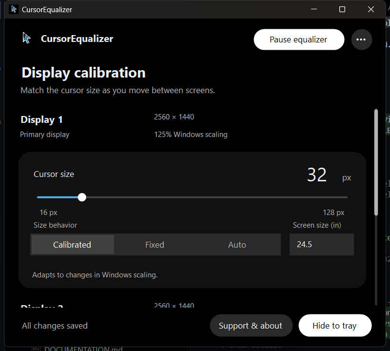

# CursorEqualizer

A Windows system tray utility for tuning cursor size across monitors with different display scaling.

Status: 'Active development' · A personal project by [MelvynPals](https://github.com/MelvynPals).



## What it does

- Set cursor sizes from 16 to 128 pixels for each monitor, with live preview and automatic saving.
- Use Calibrated mode to preserve a chosen size reference as Windows display scaling changes.
- Read the active cursor theme's custom `.cur` and `.ani` paths from the Windows Registry.
- Keep running in the tray when Settings closes; pause, resume, reload cursors, or exit from the tray menu.
- Start at Windows sign-in using a standard startup entry or an elevated scheduled task.
- Restore the registered Windows cursor scheme when paused or exited normally.

Calibration is hands-on: choose a comfortable size on each display and compare it visually. Equal physical appearance depends on your screens and cursor theme.

## Tech stack


| Layer | Technology |
| --- | --- |
| Language and runtime | C# / .NET 8, targeting `net8.0-windows` |
| Desktop UI | Windows Forms with custom dark controls |
| Cursor and display APIs | Win32 P/Invoke, including `user32.dll` and `shcore.dll` |
| Settings | Local JSON and per-user Registry entries |
| Elevated startup | Windows Task Scheduler |
| Release packaging | Per-user Windows x64 installer with bundled .NET runtime |
| Development / portable target | Direct executable, with optional framework-dependent single-file publishing |

## Getting started

### Prerequisites

- A Windows PC; current verification was performed on Windows 11.
- The .NET 8 SDK to build from source.
- The installer bundles the .NET runtime. A portable framework-dependent executable needs the .NET 8 Windows Desktop Runtime x64 separately.
- Multiple monitors to use and verify per-monitor calibration.

### Build and run

```powershell
git clone https://github.com/MelvynPals/win-cursor-equalizer.git
cd win-cursor-equalizer
dotnet build
dotnet run
```

Settings opens with a tray icon. Only one instance can run at a time. If another copy is already running, open Settings from that tray icon or exit it before launching a new build. Windows may place the icon in the hidden-icons area.

### Calibrate your displays

1. Move Settings onto the monitor you want to tune.
2. Select 'Calibrated' and adjust its cursor slider to a comfortable size.
3. Repeat on the other monitor, comparing the visible cursor size. Changes save automatically after a short delay.
4. Choose 'Hide to tray' or close Settings to keep the equalizer running.

| Mode | Behavior |
| --- | --- |
| Calibrated | Saves a pixel size and DPI reference, then compensates when that monitor's scaling changes. This is the visually verified workflow on the test setup. |
| Fixed | Keeps the selected pixel size for that monitor across scaling changes. |
| Auto | Uses effective DPI and supplied screen diagonals. Its physical-size formula remains experimental; it has not been validated for equal appearance. |

The shared tray / More actions menu provides Pause/Resume, Reload Cursors from Registry, startup options, and 'Exit & Restore Default Cursors'. Standard startup uses a per-user Registry Run entry. Elevated startup uses Task Scheduler and requests administrator approval when configured.

### Useful commands

Run app diagnostic commands after exiting the existing instance. GUI smoke tests change system cursors briefly and restore them on exit.

| Command | Purpose |
| --- | --- |
| `dotnet build` | Compile the desktop app |
| `dotnet run` | Open Settings and start the tray app |
| `dotnet run -- --minimized` | Start with Settings hidden |
| `dotnet run -- --list` | List detected monitors, DPI, modes and target sizes |
| `dotnet run -- --ui-smoke-test` | Run the GUI for two seconds, then exit and restore cursors |
| `dotnet run -- --smoke-test` | Run the console engine for two seconds, then restore cursors |
| `dotnet run -- --restore` | Restore the registered cursor scheme without loading settings |
| `dotnet run --project tests/Phase2Checks/Phase2Checks.csproj` | Run focused sizing, persistence and startup checks |
| `dotnet publish -c Release -p:PublishProfile=WinX64` | Publish the Windows x64 single-file app |

## Architecture

The app polls cursor position and monitor identity about every 15 ms. It replaces cursors when the pointer enters another monitor or an explicit settings/display refresh requires reapplication. Ordinary polling ticks on the same monitor do not reload cursor files. Monitor detection, cursor handling, persistence and UI have separate owners.

| File or directory | Responsibility |
| --- | --- |
| `Program.cs` | DPI awareness, single-instance mutex and global cleanup hooks |
| `NativeMethods.cs` | Centralized P/Invoke declarations, Win32 structures and constants |
| `CursorManager.cs` | Monitor detection, sizing, cursor replacement and restoration |
| `SettingsManager.cs`, `SettingsManager.Startup.cs` | JSON persistence, Registry startup and Task Scheduler |
| `TrayAppContext.cs` | WinForms message loop, polling timers and app lifecycle |
| `MainForm*.cs`, `DesignControls.cs`, `DesignScrollBar.cs` | Calibration window, support drawer, tray menu and controls |
| `Assets/` | Embedded executable icon, branding and receiving QR image |
| `tests/Phase2Checks/` | Dependency-free engine and settings checks |
| `tools/` | Icon export and external process-performance sampling |
| `references/` | Technical documentation, work tracking, screenshots and measurements |

Settings are stored in `%AppData%\CursorEqualizer\settings.json`, keyed by monitor identity. Saved entries for disconnected displays are retained. Invalid settings are reported rather than silently overwritten. Cursor source paths are read from `HKCU\Control Panel\Cursors`.

## Publishing and updates

Build the installable release with the .NET 8 SDK and Inno Setup 6.7+ or 7:

```powershell
powershell -NoProfile -ExecutionPolicy Bypass -File tools/Build-Installer.ps1
```

Output: `artifacts\installer\CursorEqualizer-<version>-Setup.exe`. Setup installs into `%LocalAppData%\Programs\CursorEqualizer`, creates a Start menu search shortcut, and registers uninstall in Windows Settings / Programs and Features. Newer versions upgrade the same installation and preserve calibration. Normal development still uses `dotnet run` without installing.

Select standard startup during setup to control it through Task Manager > Startup apps or Windows Settings > Apps > Startup. An upgrade preserves Windows' disabled state. The advanced Elevated mode uses Task Scheduler instead and is separate from that toggle. Existing elevated startup may require administrator approval during migration or uninstall.

Exit the running app through its tray menu before installation, upgrade or uninstall. Uninstall removes startup and installed files while retaining calibration data. The generated installer is currently unsigned. See [installer documentation](installer/README.md) for lifecycle details and verification status in [TODO.md](references/TODO.md).

For a portable development copy with a separately installed runtime, the original command remains:

```powershell
dotnet publish -c Release -p:PublishProfile=WinX64
```

Output: `bin\Release\net8.0-windows\win-x64\publish\CursorEqualizer.exe`.

The portable publish profile embeds assets and debug symbols into one executable and leaves trimming disabled. Copy the executable to a stable location on a PC with the required Windows Desktop Runtime. Exit the running app through its tray menu before replacing the file. Settings stay in AppData.

If you move the executable, open the new copy and reselect the desired Windows startup mode so its registered path is updated. Keep a previous executable if you need to revert an update.

## Measured performance

Recorded on Windows 11 Home with an Intel Core i5-14400F, 16 logical processors and 31.76 GiB OS-reported physical RAM, using the warmed-up 1.0.0 build on 2026-10-25.

| Sample | Duration | Average total CPU | Highest one-second CPU | Average resident RAM |
| --- | ---: | ---: | ---: | ---: |
| Background tray | 61.06 s | 0.016% | 0.289% | 82.63 MiB |
| User-driven rapid monitor crossings | 10.15 s | 0.837% | 1.058% | 84.30 MiB |

CPU percentages are normalized across all logical processors. These short samples describe one PC; the crossing rate and response latency were not measured. They do not establish long-term memory stability or performance on other hardware. See [the performance record](references/PERFORMANCE.md) for raw CSV/JSON, executable hashes, methodology and claim limitations.

## Recovery and known limitations

The app changes Windows system cursors for the current session. Normal exit and the registered shutdown/error handlers restore the Registry cursor scheme. Force termination cannot execute cleanup. To recover, exit any running copy first and run the published executable with:

```powershell
.\CursorEqualizer.exe --restore
```

If there is no visible window but an instance is running, check the system tray before launching another copy. Closing Settings keeps the app running.

Physical hotplug, primary-display/resolution changes, animated-theme behavior and some startup failure paths still have open regression checks. Auto mode's diagonal formula has not been validated for physical equality. See [TODO.md](references/TODO.md) for the current verification status.

## Working in this repo

Read [AGENTS.md](AGENTS.md), [DOCUMENTATION.md](references/DOCUMENTATION.md) and [TODO.md](references/TODO.md) before changing application code. Keep native calls in NativeMethods, cursor logic in CursorManager, persistence/startup in SettingsManager, and presentation in MainForm.

Build and run each development milestone, verify behavior on physical monitors, update the reference documents, and obtain the required owner confirmation before proceeding to the next phase. Use descriptive local commits such as `feat: ...`, `fix: ...` or `docs: ...`. Repository policy reserves pushing for the owner.

## Ownership and links

Created and maintained by [MelvynPals](https://github.com/MelvynPals) as a personal project.

- [Report a bug or suggest a feature](https://github.com/MelvynPals/win-cursor-equalizer/issues).
- [Support development with PayPal](https://paypal.me/emjaypals). QR Ph support is also available in the app's Support & about drawer.
- [Technical documentation](references/DOCUMENTATION.md), [development tasks](references/TODO.md), and [performance evidence](references/PERFORMANCE.md).
